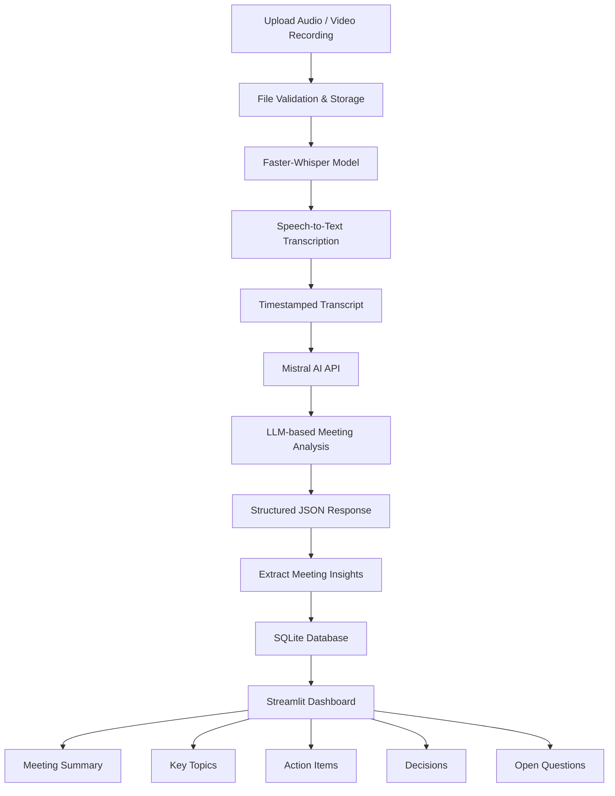

# ✦ TeamTrace
### Transform Conversations into Actionable Insights

**TeamTrace** is an AI-powered meeting intelligence application designed to simplify meeting documentation and improve team productivity.

It converts audio and video meeting recordings into structured, meaningful information using Speech-to-Text technology and Large Language Models (LLMs).

Instead of manually listening to recordings, preparing meeting minutes, identifying action items, and tracking decisions, TeamTrace automates much of this process.

The goal is to help individuals and teams turn conversations into organized knowledge and actionable outcomes.

> 🚧 **Project Status: Under Development**
>
> The core meeting-processing pipeline, AI-powered analysis, database integration, and basic dashboard are implemented. Advanced task management, collaboration, authentication, and cloud-based features are planned for future development.

---

## 📌 Table of Contents

- [Problem Statement](#-problem-statement)
- [Project Vision](#-project-vision)
- [Key Features](#-key-features)
- [Application Workflow](#-application-workflow)
- [Technology Stack](#-technology-stack)
- [System Architecture](#-system-architecture)
- [Project Structure](#-project-structure)
- [Current Implementation](#-current-implementation)
- [Installation and Setup](#-installation-and-setup)
- [Contributing](#-contributing)

---

## 🎯 Problem Statement

Meetings are an essential part of team collaboration, but managing the information generated during meetings can be challenging.

Common problems include:

- Important discussion points getting lost.
- Manually preparing meeting summaries and minutes.
- Difficulty identifying tasks and assigning responsibilities.
- Forgetting decisions made during discussions.
- Lack of a centralized place to revisit previous meeting information.
- Spending additional time reviewing lengthy recordings.

TeamTracems to address these problems by using AI to automatically process meeting recordings and extract relevant information.

## 💡 Project Vision

The vision behind TeamTrace is to build an intelligent meeting assistant that goes beyond simple transcription.

It aims to create a system that can:

1. Understand meeting conversations.
2. Generate concise and meaningful summaries.
3. Identify important topics and decisions.
4. Extract actionable tasks.
5. Identify responsible team members and deadlines when mentioned.
6. Maintain an organized history of meetings.
7. Help teams track progress and follow up on decisions.

Ultimately, TeamTracems to transform meeting conversations into structured team knowledge.

---

## ✨ Key Features

### ✅ Implemented Features

| Feature | Description 
|---|---
| Meeting Recording Upload | Upload audio and video recordings in supported formats. 
| Speech-to-Text | Convert recordings into text using Faster-Whisper. 
| Timestamped Transcription | Generate transcript segments with timestamps. 
| AI Meeting Analysis | Analyse transcripts using the Mistral AI API. 
| Meeting Summary | Generate concise summaries of discussions. 
| Topic Extraction | Identify important topics discussed during meetings. 
| Action Item Extraction | Extract tasks, assignees and deadlines when mentioned. 
| Decision Extraction | Identify decisions made during meetings. 
| Open Question Detection | Identify unresolved questions. 
| Meeting Storage | Save transcripts and AI-generated analysis in SQLite. 
| Meeting History | Retrieve previously saved meetings and their insights. 
| Dashboard | Display meeting statistics and recent meetings. 
| Basic Task View | Display action items extracted from saved meetings. 

### 🚧 Features Under Development

- Interactive task management.
- Task assignment and completion tracking.
- Improved meeting organization.
- Enhanced dashboard analytics.
- Better application settings and configuration.
- Improved validation and error handling.

### 🔮 Planned Features

- User authentication and personalized workspaces.
- Team-based collaboration.
- Cloud-based meeting storage.
- Meeting search and filtering.
- Export meeting summaries and reports.
- Calendar integration.
- Automated meeting follow-ups and reminders.
- Advanced AI-powered meeting insights.

---

## 🔄 Application Workflow

TeamTrace follows a multi-stage AI processing pipeline.



### Step-by-Step Explanation

**1. Recording Upload**

Users upload an audio or video recording through the Streamlit interface.

Supported formats:

- Audio: MP3, WAV, M4A
- Video: MP4, MOV, MKV, WEBM

**2. Speech-to-Text Conversion**

The uploaded recording is processed using Faster-Whisper.

The model converts spoken conversations into text and generates timestamped transcript segments.

**3. AI-Powered Meeting Analysis**

The generated transcript is passed to the Mistral AI API.

A structured prompt instructs the LLM to extract:

- Meeting summary.
- Key discussion topics.
- Action items.
- Assignees and deadlines.
- Decisions.
- Unresolved questions.

**4. Structured JSON Generation**

Mistral returns the extracted information in JSON format, allowing the application to process and display each category separately.

**5. Database Storage**

Meeting details, transcripts, and AI-generated insights are stored in an SQLite database.

**6. Dashboard and Meeting History**

Users can revisit saved meetings, view their transcripts, explore extracted insights, and review tasks.

---

## 🛠 Technology Stack

| Technology | Purpose |
|---|---|
| Python | Core application logic |
| Streamlit | Interactive web interface |
| Faster-Whisper | Speech-to-text transcription |
| Mistral AI API | LLM-powered meeting analysis |
| SQLite | Local relational database |
| JSON | Structured AI-generated output |
| Requests | API communication |
| Python-dotenv | Environment variable management |
| CSS | Custom application styling |

### Important Technical Details

**Faster-Whisper**

- Uses the Whisper Small model.
- Runs locally on CPU.
- Uses INT8 computation.
- Uses beam search for transcription.
- Uses Voice Activity Detection (VAD) filtering.

**Mistral AI**

- Uses the `mistral-small-latest` model.
- Processes meeting transcripts.
- Generates structured JSON responses.
- Extracts tasks, decisions, topics, and summaries.

**SQLite**

The application currently maintains a local database with a `meetings` table.

The table stores:

| Column | Description |
|---|---|
| id | Unique meeting identifier |
| title | Meeting title |
| recording_name | Recording filename |
| transcript | Generated transcript |
| analysis | AI-generated meeting insights in JSON |
| created_at | Meeting creation timestamp |

---

## 🏗 System Architecture

TeamTrace currently follows a modular architecture with separate responsibilities for the user interface and core processing logic.

### Application Layer

**`app.py`**

Responsible for:

- Streamlit application initialization.
- Sidebar navigation.
- Dashboard rendering.
- Recording upload interface.
- Transcription and AI analysis interactions.
- Meeting history.
- Task display.
- Settings page.

### Core Processing Layer

**`core.py`**

Responsible for:

- Faster-Whisper model initialization.
- Audio/video transcription.
- Timestamp formatting.
- Mistral API integration.
- Structured JSON response validation.
- SQLite database initialization.
- Saving and retrieving meetings.

### Presentation Layer

**`styles.css`**

Responsible for:

- Custom dark theme.
- Dashboard styling.
- Metric cards.
- Sidebar appearance.
- Upload interface styling.
- UI consistency.

### Data Layer

**SQLite Database**

Responsible for persistent local storage of:

- Meeting information.
- Transcripts.
- AI-generated analysis.
- Creation timestamps.

---

## 📂 Project Structure

```text
TeamTrace/
│
├── app.py                  # Main Streamlit application
│
├── core.py                 # Core AI processing and database logic
│
├── styles.css              # Custom application styling
│
├── requirements.txt        # Project dependencies
│
├── .gitignore              # Git ignored files
│
├── .env                    # Environment variables (not committed)
│
├── uploads/                # Uploaded meeting recordings
│   └── .gitkeep
│
└── teamtrace.db            # SQLite database (generated locally)
```

---

## 🚀 Installation and Setup

Follow these steps to run TeamTrace locally.

### 1. Clone the Repository

```bash
git clone https://github.com/Akanksha-1708/TeamTrace.git

cd TeamTrace
```

### 2. Create a Virtual Environment

```bash
python -m venv venv
```

Activate it:

**Windows:**

```bash
venv\Scripts\activate
```

**Linux / macOS:**

```bash
source venv/bin/activate
```

### 3. Install Dependencies

Install the required packages:

```bash
pip install streamlit faster-whisper requests python-dotenv
```

### 4. Configure Environment Variables

Create a `.env` file in the root directory.

Add your Mistral API key:

```env
MISTRAL_API_KEY=your_mistral_api_key
```

Obtain an API key through the [Mistral AI Console](https://console.mistral.ai/).

**Important:** Never commit your `.env` file or expose your API key publicly.

### 5. Run the Application

```bash
streamlit run app.py
```

The application will start locally and Streamlit will provide a browser URL, typically:

```text
http://localhost:8501
```

---

## 📊 Current Implementation

The following table summarizes the development progress.

| Component | Current State | Next Step |
|---|---|---|
| Streamlit UI | Implemented | UI/UX improvements |
| Recording Upload | Implemented | Upload validation improvements |
| Faster-Whisper | Implemented | Performance optimization |
| Transcription | Implemented | Better transcript editing |
| Mistral Integration | Implemented | Improved output validation |
| Meeting Analysis | Implemented | More advanced insights |
| SQLite Storage | Implemented | Scalable cloud database |
| Meeting History | Implemented | Search and filtering |
| Dashboard | Basic implementation | Advanced analytics |
| Task Management | Basic implementation | Interactive task lifecycle |
| Authentication | Not implemented | User authentication |
| Team Collaboration | Not implemented | Shared workspaces |
| Cloud Storage | Not implemented | Cloud-based persistence |
| Export Functionality | Not implemented | PDF and CSV exports |

---

## ⚠️ Known Limitations

TeamTrace is currently under active development. Some limitations include:

1. **Local Processing:** Transcription runs on the local machine and can be resource-intensive for longer recordings.

2. **External AI Dependency:** Meeting analysis requires internet connectivity and a valid Mistral API key.

3. **Local Database:** Meeting data is currently stored in SQLite rather than a centralized cloud database.

4. **No Authentication:** The current application does not implement user authentication or multi-user access control.

5. **Basic Task Management:** Extracted tasks can be viewed but cannot yet be assigned, edited, or marked as .

6. **No Real-Time Processing:** The current implementation works with uploaded recordings rather than live meetings.

7. **No Cloud Deployment:** The application is currently designed for local execution.

These limitations define the areas of ongoing development and future improvement.

---

## 🤝 Contributing

Contributions, suggestions, and feedback are welcome!

If you would like to contribute:

1. Fork the repository.
2. Create a new feature branch.
3. Make your changes.
4. Test your implementation.
5. Submit a Pull Request with a clear description of your changes.

```bash
git checkout -b feature/your-feature-name

git add .

git commit -m "Add your feature description"

git push origin feature/your-feature-name
```

---

## 🎯 Project Objective

TeamTrace is an exploration of how Speech AI and Generative AI can work together to solve practical productivity problems.

By combining automatic speech recognition, LLM-powered information extraction, and structured data storage, the project aims to build a reliable meeting intelligence platform.

**The long-term goal is simple:**

### Don't just record meetings. Understand them. Organize them. Turn them into action.

---

## 👩‍💻 Author

**Akanksha Dwivedi**

B.Tech Computer Science and Engineering

GitHub: [@Akanksha-1708](https://github.com/Akanksha-1708)

---

*TeamTrace — From Conversations to Actionable Intelligence.*
